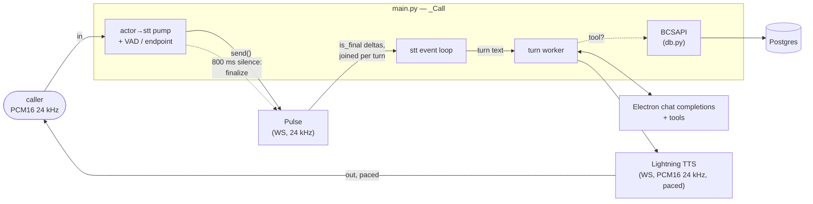

# app

The Python package for Riley. Four modules: the FastAPI app that *is* the
agent process and hosts the whole cascaded pipeline, the tool schemas +
dispatcher, the Postgres-backed card-ops layer the tools call, and a small
Veris reporting shim. Container startup and how to run a simulation live in the
[top-level README](../README.md); this doc is about the code.

| Module | Role |
|--------|------|
| `main.py` | The whole agent process. A FastAPI app exposing `WS /voice` (and `/health`); each connection opens a Pulse streaming-STT session and runs the pipeline in `_Call` — VAD and endpointing on the caller's audio, a non-streaming Electron chat completion with the five tools, and paced Lightning TTS for the reply. |
| `tools.py` | The five card-ops tools in OpenAI's function-calling shape (Electron is OpenAI-compatible), and `dispatch()`, which maps a tool call to the corresponding `BCSAPI` method. |
| `reporting.py` | Veris integration shim. `report_tool_call` fire-and-forgets each tool call to the sandbox engine so it lands in the graded trace; a no-op outside a simulation. |
| `db.py` | The card-ops schema (pydantic models + enums), a psycopg2 `Database` wrapper, and `BCSAPI`, the validated facade the tools go through. See also [`db/README.md`](../db/README.md) for the data itself. |

`__init__.py` is empty — this is a plain namespace package, run as
`uvicorn app.main:app`.

## How one call flows through the package

1. A caller opens `WS /voice`. `main.py` connects to Pulse, then the turn
   worker speaks the greeting (not interruptible) so Riley opens the call.
2. Every inbound 20 ms frame is measured (`audioop.rms`) and forwarded to Pulse
   unconverted — both run at 24 kHz. The RMS is the VAD: it decides both
   barge-in and, after `END_OF_TURN_S` of silence *in audio time*, the
   endpoint.
3. At the endpoint the pump sends `{"type": "finalize"}`. Pulse's `is_final`
   transcripts are deltas, not restatements, so the turn's text is every final
   since the last turn joined together; the final carrying `from_finalize:
   true` closes the turn.
4. The turn worker appends the turn, calls `chat.completions.create` against
   Electron with the five tools, and loops while the model keeps calling them:
   each call goes through `tools.dispatch` → `BCSAPI` (validation) →
   `Database` (SQL) → Postgres, and comes back as a `tool` message.
5. The final text is streamed through Lightning TTS and sent to the caller in
   paced 500 ms slices (at most 1 s ahead of playback), so a voiced frame
   arriving mid-reply — a barge-in — actually has unplayed audio left to cut.
   The interrupted reply is then trimmed in the message history to what the
   caller is estimated to have heard.

Turns are queued and handled one at a time, so the message list is only ever
touched by the worker even when the caller talks over a reply.
